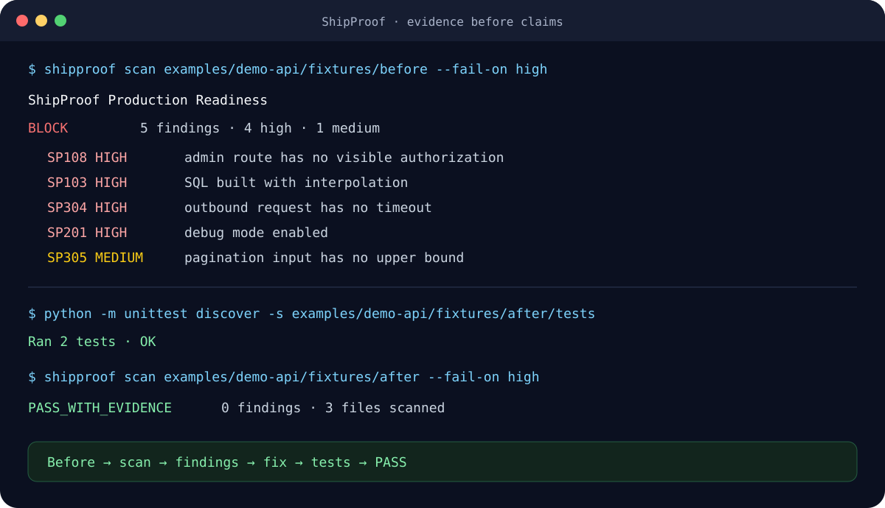
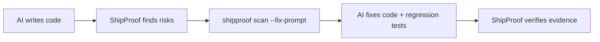

<p align="center">
  
</p>

<h1 align="center">ShipProof</h1>

<p align="center"><strong>A local-first production evidence gate for AI-assisted software.</strong></p>

<p align="center"><a href="README.md">English</a> · <a href="README.th.md">ภาษาไทย</a></p>

Security · Correctness · Scale · Performance · Release evidence

[](https://github.com/kingggg5/shipproof/actions/workflows/ci.yml)
[](https://github.com/kingggg5/shipproof/actions/workflows/security.yml)
[](CHANGELOG.md)
[](package.json)
[](pyproject.toml)
[](LICENSE)

ShipProof is an independently developed production gate for repositories written by people, coding agents, or both. It scans source without executing repository code, evaluates measured CPU/RAM/latency budgets, models reviewed capacity assumptions, and emits evidence through terminal output, JSON, SARIF, pre-commit, GitHub Actions, or an optional read-only MCP adapter.

ShipProof is not a certification, penetration test, formal proof, or substitute for product-specific threat modeling and runtime tests. It makes assumptions visible, reports the strength of available evidence, and preserves human authority for consequential actions and releases.

**Project resources:** [Website](https://shipproof-site.sjet2744.chatgpt.site/shipproof/) · [Commands](docs/commands.md) · [Contributing](CONTRIBUTING.md) · [Support](SUPPORT.md) · [Governance](GOVERNANCE.md) · [Security](SECURITY.md) · [Community validation](https://github.com/kingggg5/shipproof/blob/main/docs/community-validation.md) · [Research methodology](https://github.com/kingggg5/shipproof/blob/main/docs/research.md) · [Roadmap](https://github.com/kingggg5/shipproof/blob/main/docs/roadmap.md) · [Citation](CITATION.cff)

<p align="center">
  
</p>

## Understand it in 30 seconds

The checked-in [demo API](examples/demo-api/README.md) contains five real, intentionally vulnerable code paths: missing admin authorization, interpolated SQL, unbounded pagination, a missing outbound timeout, and production debug mode.

```bash
shipproof scan examples/demo-api/fixtures/before --fail-on high
# BLOCK · 5 findings

python -m unittest discover -s examples/demo-api/fixtures/after/tests -v
shipproof scan examples/demo-api/fixtures/after --fail-on high
# PASS_WITH_EVIDENCE · 0 findings
```

The test suite verifies the exact before/after contract. Additional [Node.js, Python, secure, and performance fixtures](fixtures/README.md) guard against missed findings and obvious false positives.

## Quickstart

Run directly in any repository without creating a configuration file first:

```bash
npx github:kingggg5/shipproof check
```

The git form works without any registry credentials. Once the package is published to the public npm registry, the shorter `npx @kingggg5/shipproof check` will also work; GitHub Packages requires authentication even for public packages, so it is not used for the one-liner.

Or install globally:

```bash
npm install --global github:kingggg5/shipproof
shipproof doctor .
shipproof init . --target both
shipproof check .
```

`init` adds repository-scoped skills to `.agents/skills` for Codex and `.claude/skills` for Claude Code. It skips existing skill directories unless you explicitly pass `--force`.

Node.js 20+ runs the front-door CLI. Python 3.10+ is needed for `scan`, `check`, all `gate` and `labs` commands, and the MCP tools. The core has no runtime npm or Python package dependencies.

## Scope and project status

ShipProof applies the same review contract regardless of who wrote the code. Its executable scanner currently contains **667 deterministic rules** (`SP001`–`SP707`, with deliberate gaps) for locally observable security, correctness, scale, performance, configuration, and supply-chain risks. The default path is read-only, offline, and dependency-free beyond Node.js and the Python standard library.

| Property | Current contract |
| :--- | :--- |
| Current release | `v0.12.0` reviewed release |
| Runtime | Node.js 20+; Python 3.10+ for scanner-backed commands |
| Executable rules | 667 (`SP001`–`SP707`, with deliberate reserved gaps) |
| Evidence levels | `L0` pattern, `L1` structural/artifact, `L2` interprocedural taint (`--cross-file`; Python + JavaScript/TypeScript) |
| Research inventory | 7,800 catalogued candidates plus 1,000 reserved promotion slots; none are findings until promoted |
| Exit codes | `0` pass, `1` policy gate failure, `2` invalid or unavailable evidence |
| Default data flow | Local filesystem and subprocesses only; no telemetry or source upload |

Rule design is informed by primary references such as [MITRE CWE](https://cwe.mitre.org/), [OWASP ASVS](https://owasp.org/www-project-application-security-verification-standard/), [OWASP API Security](https://owasp.org/API-Security/), [NIST SSDF](https://csrc.nist.gov/pubs/sp/800/218/final), owning framework documentation, and real vulnerability records. A source identifies a risk class; it does not automatically justify a detector. Promotion requires local observability, a bounded implementation, positive/negative/adversarial fixtures, mappings, remediation, and a documented false-positive boundary.

## Trust model

Current source adds advisory checks for Roblox/Luau `.lua`/`.luau` files
(`SP671`–`SP672`) and Rust invalid reference initialization (`SP673`), plus
direct reqwest TLS configuration in `SP104`. See the [rule boundaries](docs/rules.md)
for supported syntax and limitations. The registry above describes this checkout;
tagged release notes describe their published artifacts.

The Luau callback boundary includes simple optionally typed RemoteEvent and
RemoteFunction handlers; `SP672` recognizes `OnServerInvoke` and an optional
return, but event ownership remains unresolved.

The TypeScript/JavaScript configuration cohort (`SP674`–`SP682`) adds import-aware
advisories for explicit JWT, Node, Next.js, Electron and Puppeteer security opt-outs.
Type-only imports do not trigger `SP591`. `SP429` is retired: Express's JSON parser
already has a bounded default. See the [rule boundaries](docs/rules.md) and
[source/fixture record](https://github.com/kingggg5/shipproof/blob/main/research/typescript-cohort-2026-10.md).

`SP676` also covers imported `jsonwebtoken.sign` with explicit RS/PS/ES
algorithms and no header override. `SP679` also recognizes `httpValidation:
'insecure'` on supporting Node versions; strict/relaxed modes and conflicting
legacy switches stay quiet. `SP690`–`SP692` are bounded advisory checks described
in the [Luau/TypeScript cohort record](research/luau-typescript-cohort-2026-10.md);
they do not establish deployment or actual RSA key strength.

The offline advisory snapshot reviewed **22 October 2026** includes PHP2Shell
(`CVE-2026-109618`, `CVE-2026-109619`) as `SP683`. It checks explicit PHP pins and
final official FPM/Apache image declarations; it does not infer runtime versions
from Composer constraints or prove deployed exposure. Verify vendor backports and
upgrade the actual web runtime. See the [PHP2Shell boundaries](docs/rules.md#php2shell-version-evidence).

`SP684` checks exact Node.js pins against the October 2026 security baseline; `SP685` checks upstream EOL. Both are advisory. See [supported declarations and limits](docs/rules.md#nodejs-version-declarations).

`SP686`/`SP687` advise on legacy Node TLS selection (handshake unverified) and `ws maxPayload` literals that become nonpositive after signed-32-bit conversion; omission keeps a finite cap. Typed C# `CookieAuthenticationOptions` assignments extend `SP056`/`SP084`; middleware can override local settings. Dart HTTP coverage of `SP170` requires imported `package:http`, a literal external HTTP URI and an explicit Authorization key; values and transport remain unverified. Legacy FTP/Telnet signatures are unchanged. See [transport boundaries](docs/rules.md#transport-and-cookie-options).

The prior TypeScript/.NET/Dart field cohort documented advisory SP688/SP689 for narrowly bounded Next.js image and Kestrel settings. These local configurations do not establish exploitable deployment or absence of proxy/per-request caps; see the [field-cohort record](research/field-cohort-ts-dotnet-dart-2026-10.md).

The broad-quality cohort adds medium advisories SP693–SP698 and narrows SP346/SP375 while retiring SP348. The signatures describe local source, not deployment impact. Authored cases, native API probes, pinned field observations and measured budgets are recorded in the [cohort evidence](research/broad-quality-cohort-2026-10.md).

| ShipProof guarantees | ShipProof does not claim |
| :--- | :--- |
| Deterministic output for the same supported inputs and version | Absence of vulnerabilities or production incidents |
| Stable rule IDs, schemas, fingerprints, and `0/1/2` exit semantics | Cross-file reachability or runtime exploitability from regex alone |
| Redacted evidence and no repository-code execution in the default scanner | Compliance certification for CWE, OWASP, NIST, or another standard |
| Explicit unknown/unavailable evidence rather than a fabricated pass | A universal capacity target, SLO, or architecture |
| Review-first severity for heuristics that need context | Replacement of CodeQL, dependency/SBOM tools, fuzzing, or human review |

## Evidence output

ShipProof formats findings as actionable review cards with source context, confidence levels, why the risk matters, and recommended fixes:

```text
  [BLOCK] ShipProof: BLOCK
  Scanned 24 files | 1 blocking issue | 0 suppressed
  HIGH: 1

  [HIGH] Sensitive route lacks visible authorization (SP108)
     src/routes/admin.py:42  |  confidence: LIKELY

     Evidence:
       40   
       41   @app.post("/admin/users/{user_id}/ban")
       42 > def ban_user(user_id: str):
       43       return db.ban(user_id)

     Why: An admin or internal route has no visible authorization dependency.
     Fix: Require an explicit authorization dependency or verify application-wide control.
     Ref: CWE-862 | OWASP ASVS V4

  ----------------------------------------------------------------------

  -> Run `shipproof scan --fix-prompt` to generate AI-ready fix instructions
  -> Run `shipproof explain SP108` for attack scenarios and testing guidance
```

## Verification workflow

ShipProof turns development into a verified feedback loop: AI writes code, ShipProof finds risks, AI fixes with explicit constraints, and ShipProof re-verifies.

<p align="center">
  
</p>

If verification blocks the change, the evidence goes back into the fix-and-test step. A pass means the configured gate has evidence for the reviewed scope—not that the software is universally vulnerability-free.

<details>
<summary>Accessible workflow source</summary>



</details>

```bash
shipproof scan --fix-prompt        # structured handoff for Codex/Claude Code/Cursor/Copilot
shipproof explain SP108            # rationale, attack scenario, false positives, test plan
shipproof labs impact src/app.py   # experimental blast radius before editing
```

Full prompt samples, invariant analysis, token cost budgeting, worktree isolation, status badges, and `--trace` output live in [docs/features.md](docs/features.md).

## Detection rules

**667 deterministic executable rules** (`SP001`–`SP707`, with deliberate reserved gaps) across security, correctness, scale, performance, configuration, and supply-chain risks. Findings carry an evidence `proof_level`: `L0` pattern match, `L1` structural/AST/artifact evidence, and `L2` interprocedural taint flows (`--cross-file`; Python plus JavaScript/TypeScript route-to-sink chains since v0.8).

Selected source-level advisories include these additional boundaries:

| Rule | Catalog title | Advisory boundary |
| :--- | :--- | :--- |
| `SP336` | Node inline file stream has no source error handler | Only direct imported fs.createReadStream(path).pipe(createWriteStream(path)) with no options, escapes, prototype handlers, or native handlers; named streams and Zod pipe are not proof |
| `SP690` | Roblox remote directly requires a client-selected module | Requires a local `Instance.new` remote, unescaped handler, two simple optionally typed parameters, and one direct sink statement; aliases, guards, complex parameters, and deployment remain unknown |
| `SP691` | Roblox remote directly removes a client-selected object | Direct Destroy or Kick on the client-selected argument; requires a local native remote and one sink statement; authorization and target type remain unknown |
| `SP692` | JWT RSA signing key-size safeguard explicitly disabled | Requires imported `jsonwebtoken.sign`, explicit RS/PS algorithm and no header override; actual key strength is unknown |
| `SP693` | Node HTTP receive deadlines explicitly disabled | Requires directly imported server options with both literal request/header timeouts zero; external bounds remain unknown |
| `SP694` | Direct await of an empty asynchronous race | Requires directly awaited literal `[]` in native Promise.race or Dart Future.any with explicit dart:async import; wrappers and complex bindings are excluded |
| `SP695` | Native array sort comparator returns a boolean | Requires a literal array with at least two elements and a simple boolean comparator |
| `SP696` | XML entity expansion limit explicitly removed | Requires inline settings passed to XmlReader.Create, DTD parsing, zero entity-character limit and no finite document cap; not proof of external entity access |
| `SP697` | Unverified logging configuration listener explicitly started | Requires direct logging.config.listen import, literal valid port, verify=None and immediate start(); standard listener is loopback only |
| `SP698` | Awaited synchronous compression still blocks the caller | Requires a directly awaited imported Node zlib synchronous call; input size and actual work are unknown |
| `SP699` | Rust unchecked NonZero construction receives zero | Qualified native constructor and literal zero; custom/imported module identities remain unresolved |
| `SP700` | Node timer delay exceeds its supported range | Imported callback/promise API and bounded decimal value/product; no global timer inference |
| `SP701` | SQLAlchemy QueuePool capacity explicitly unlimited | Explicit zero size or unlimited overflow on an import-bound QueuePool; engine defaults are not inferred |
| `SP702` | React effect setup is an async function | Imported effect and inline async setup; inner async work in synchronous setup stays silent |
| `SP703` | Await uses a callback Node I/O API | Direct await of imported callback pipeline/readFile/writeFile; promises APIs, wrappers, and shadows stay silent |
| `SP704` | PostgreSQL URL overrides an explicit custom-CA TLS object | Imported pg constructor with literal URL SSL parameters and a separate CA object; no connection is made |
| `SP705` | PostgreSQL concurrent index operation is inside a transaction | Concurrent CREATE/DROP INDEX or REINDEX INDEX/TABLE inside an explicit same-file transaction; other options and runner state remain unresolved |
| `SP706` | PostgreSQL definer SELECT searches temporary relations first | SQL definer function, temp-first explicit path and unqualified relation; deployed privileges remain unknown |
| `SP707` | Roblox remote writes client-selected DataStore keys and values | Flat local native remote, three distinct simple parameters, direct native DataStore SetAsync with client key/value; guards, aliases, shared-store intent and runtime exposure remain unresolved |

These findings are advisory evidence about local source, not proof of deployed exposure or exploitability. See the [Luau/TypeScript cohort](research/luau-typescript-cohort-2026-10.md) and the [broad-quality cohort](research/broad-quality-cohort-2026-10.md).

The [value/default/trust cohort](research/value-cohort-2026-10.md) adds SP699–SP701,
extends SP673/SP104 and retires SP347/SP350. Default gather exception propagation
and omitted engine pool settings are not, by themselves, defects.

The [Node/React/Luau/PostgreSQL cohort](research/web-database-cohort-2026-10.md)
adds SP702–SP706 and extends SP691; this earlier cohort had 667 rules through SP706. SP325/SP334/SP359/SP363/SP423/SP367 are retired, with IDs reserved. SP336 is repaired under its existing ID. Missing local settings do not establish a defect, and Express 5 forwards rejected handler promises. Thresholds remain unchanged. See the [I/O ownership cohort](research/io-ownership-cohort-2026-10.md) and [SP423 review inventory](research/io-ownership-review-2026-10.json); the review does not establish whole-component safety.

The [complete source catalog](https://github.com/kingggg5/shipproof/blob/main/docs/rule-catalog.md) lists every rule's severity, category and detection method. The shipped [rule guide](docs/rules.md) explains boundaries and ecosystem mapping; `shipproof explain SPxxx` provides individual rule details offline.

## False Positive Control

ShipProof prioritizes high precision over noisy alerts:

For example, `SP631` requires an explicit Edge runtime declaration plus a native runtime import; ordinary Node.js code and prose mentioning a runtime or ledger are not Edge evidence. See the [rule boundary](docs/rules.md).

Precision signatures require relevant code and framework context. Realistic negative tests cover similar-looking safe code; see the [rule boundaries](docs/rules.md).

- **Inline suppression:** Add `# shipproof-ignore SP101` or `// shipproof-ignore SP101` directly on the line or on the line immediately preceding it. The marker is honored only inside a comment (or at the start of a documentation line), never inside string data, and may list several rules at once (for example `# shipproof-ignore SP101 SP102`). Both the regex and the Python AST engines honor these markers.
- **Confidence filtering:** Run with `--min-confidence high` to surface high-confidence heuristic findings; these still require verification.
- **Accuracy note:** Workflow findings depend on run-context interpolation, environment-file findings require a verified Git index (not `.gitignore` text), BullMQ findings require an explicit stalled-check opt-out, fetch findings require adjacent independent requests in the same component, and non-null findings require JSON-source dereference. No universal precision claim is implied.
- **Reviewed baselines:** Generate `.shipproof-baseline.json` with `shipproof scan --baseline-out .shipproof-baseline.json --baseline-reason "Reviewed migration debt"`, then review it before using `--baseline`. Generation is not approval; the default reason explicitly says review is required.
- **Auditable suppression:** Baselines (format version 2) combine exact finding fingerprints with reasoned glob rules. `--show-suppressed` reveals them in JSON, Markdown, terminal, or SARIF; SARIF marks them as external suppressions. Unknown fields, duplicate keys, invalid reasons, and oversized baselines fail with exit `2`. Fingerprints are not whole-file digests or signed approvals.
- **Honest coverage:** Unreadable selected files/directories, parser limits, overlong source lines (over 8,192 characters), oversized source files, symlinks/reparse points, unknown binaries, and uninspected containers prevent a complete-pass verdict. Repository scans fail closed on incomplete coverage by default; the explicit `--fail-on-incomplete` flag remains accepted for readable command intent, while `--allow-incomplete` is an intentionally visible exploratory override. GitHub Action and MCP scan defaults are also strict (set their boolean to `false` only for a reviewed exploratory run; adapters translate that to `--allow-incomplete`). The production `check` command additionally ignores repository attempts to weaken the security floor or narrow scope, scans the full root, and fails closed. Incomplete evidence reports `CONDITIONAL` while the process exits `1`, so no omitted source can silently become a green gate. Coverage describes supported source inspection, not runtime safety. See [coverage and baseline contracts](docs/commands.md#coverage-and-baseline-contracts).

## Add the GitHub Action

Add a deterministic gate to pull requests:

```yaml
name: ShipProof
on: [pull_request]
permissions:
  contents: read
jobs:
  production-gate:
    runs-on: ubuntu-latest
    steps:
      - uses: actions/checkout@v4
      - uses: kingggg5/shipproof@v0.12.0
        with:
          fail-on: high
```

The action writes a structured Markdown status card to the GitHub Step Summary. The example uses the `v0.12.0` release tag; pin the action to a reviewed full commit SHA when an immutable supply-chain reference is required.

For pull requests that touch a large repository, scan only what changed relative to the base branch:

```yaml
      - uses: actions/checkout@v4
        with:
          fetch-depth: 0
      - uses: kingggg5/shipproof@v0.12.0
        with:
          fail-on: high
          changed-since: origin/main
```

The scanner resolves the git diff (added, copied, modified, and renamed files, plus untracked files) and reports the ref under `changed_since` in JSON output. Findings outside the diff are not reported for that run; keep a scheduled full scan as the safety net.

The default report format is `sarif`, which the action writes into the workspace. To surface findings as inline Code Scanning alerts, upload that artifact with GitHub's official action after the gate step:

```yaml
      - uses: kingggg5/shipproof@v0.12.0
        with:
          fail-on: high
          format: sarif
          output: shipproof.sarif
      - uses: github/codeql-action/upload-sarif@v3
        if: always()
        with:
          sarif_file: shipproof.sarif
```

Uploading requires `permissions: security-events: write` (keep `contents: read`) on the job or workflow.

## One Policy, One Command

Commit a bounded [`.shipproof.yml`](.shipproof.yml), then run every declared repository gate:

```yaml
version: 1
scan:
  path: .
  exclude:
    - vendor/**
security:
  fail_on: high
performance:
  baseline: perf/baseline.json
  current: perf/current.json
  budget: perf/budget.json
capacity:
  config: capacity.json
```

```bash
shipproof check .
```

The dependency-free YAML subset rejects executable tags, anchors, duplicate keys, unknown fields, path traversal, and arbitrary commands. The full shape is documented by the [policy schema](schemas/shipproof-policy.schema.json).

## Two skills, one workflow

| Skill | Use it for |
| :--- | :--- |
| `$engineer-production-systems` | Bounded implementation with explicit security, CPU/RAM/latency, and failure budgets |
| `$audit-production-readiness` | Independent release gates: Security, Correctness, Data & Privacy, Scale, Operability, Supply Chain |

The full workflow diagram, systems coverage ladder, host compatibility table, and the production playbook are in [docs/features.md](docs/features.md) and [docs/production-playbook.md](docs/production-playbook.md).

## Command Reference

```text
shipproof check [path] [--config <file>]     Run every gate (works without config)
shipproof scan [path] [options]              Scan repository (--format terminal|markdown|json|sarif|github)
shipproof explain <rule-id>                  Explain a rule in detail (e.g. explain SP108)
shipproof doctor [path] [--json]             Inspect local runtime and integration health
shipproof init [path] [--scope <scope>]      Add project/global skills and a project policy
shipproof config validate [path]             Validate policy without running gates
shipproof gate budget [options]              Enforce CPU/RAM/latency regression budgets
shipproof gate evidence [path] [options]     Run allowlisted TypeScript, Go, or Rust analyzers
shipproof labs impact <file>[:line]          Experimental blast-radius analysis
shipproof labs invariants [path]             Experimental invariant analysis
shipproof labs cost [path] [options]         Experimental token/cost estimate
shipproof labs capacity [options]            Experimental capacity model and k6 export
shipproof mcp                                Start the read-only stdio MCP server
shipproof help                               Show command help
shipproof version                            Print current version
```

See [docs/commands.md](docs/commands.md) for full argument options and exit codes.

## Install from a Clone

```bash
git clone https://github.com/kingggg5/shipproof.git
cd shipproof
npm install --global .
```

Then invoke the skill while building:

```text
Use $engineer-production-systems to implement this feature with explicit security,
CPU, RAM, latency, and failure budgets.
```

Before release:

```text
Use $audit-production-readiness to audit this repository for production.
```

Claude Code can also load the repository directly as a plugin during development:

```bash
claude --plugin-dir .
```

Plugin-installed Claude skills use the namespaced commands `/shipproof:engineer-production-systems` and `/shipproof:audit-production-readiness`.

## Budgets, capacity, MCP, and layering

- **Resource budgets:** gate measured p95 latency/CPU/RAM/throughput regressions with `shipproof gate budget`; runnable samples in [examples/performance](examples/performance).
- **Capacity planning:** turn reviewed workload assumptions into a transparent model or a deterministic k6 scaffold with `shipproof labs capacity`.
- **MCP mode:** `shipproof mcp` exposes five read-only tools to any MCP client with canonical paths, bounded runtime, and redacted evidence.
- **Language-native evidence:** `shipproof gate evidence . --adapter typescript|go|rust` runs approved local analyzers without downloading dependencies, records the probed analyzer version, and bounds/redacts diagnostics. Repository-controlled TypeScript and Rust paths require explicit consent.
- **Layering:** pair ShipProof with mature SAST, SCA, secret-history, and supply-chain tools already present in your environment; it routes to them and never silently installs anything.

All detailed walkthroughs are in [docs/features.md](docs/features.md).

## Research & evaluation status

The scanner ships 667 executable rules. Behind them sits a research backlog of 7,800 catalogued candidates, separate from executable rules. The current promotion triage identifies 934 targets with a possible local signature, 435 that need dataflow evidence beyond today's engines, and 1,595 design, process, or hardware classes that a regex-based gate cannot catch; the remaining catalog entries retain discovery status until their evidence boundary is reviewed. The bounded P2 batch-A record reviews 25 direct candidates across nine requested ecosystems: 3 reached research-only `fixture_ready` and are mapped into the non-blocking SP666-SP668 wave; Wave D adds SP669-SP670 for Dart and C#/.NET; the other candidates remain research-only or rejected until their evidence boundary is met. See the [batch record](research/promotion-batch-a.json), [promotion waves](research/promotion-wave-b.md), and [broader plan](research/promotion-plan.json).

Fixture battery (median of 3 runs, `--cross-file`, labels in [benchmarks/head-to-head-labels.json](benchmarks/head-to-head-labels.json)):

| Corpus | Precision | Recall | F1 |
| :--- | :--- | :--- | :--- |
| vulnerable-node-api | 1.0 | 1.0 | 1.0 |
| vulnerable-python-api | 1.0 | 1.0 | 1.0 |
| node-taint-crossfile | 1.0 | 1.0 | 1.0 |
| adversarial-node | 1.0 | 1.0 | 1.0 |
| secure-node-api / node-secure-crossfile |: |: | 0 findings |

The version-3 label contract distinguishes expected finding locations from context-only source/helper files in a vulnerable chain, and records the expected sink lines so line-level accuracy is measurable. Those context files remain listed and hashed but do not count as false negatives for a sink-reporting detector. The adversarial corpus holds look-alikes inside comments and string literals that must stay silent, next to disguised chains (two-hop aliasing, destructured parameters, cookie-to-DOM, three-file taint) that must fire.

The opt-in real-world evaluator pins express, flask, and requests as clean baselines plus juice-shop, DVWA, and NodeGoat as intentionally vulnerable apps. The reviewed 2026-08-24 manifest run scanned 1,805 files and observed 310 application-scope findings (2 / 9 / 3 / 184 / 84 / 28 in that order). Every alert remains explicitly `unreviewed`; these inventory counts are not a real-world precision claim.

Operating profile: no repository or contributor limits, fully offline against local files only, and interprocedural taint for JavaScript/TypeScript and Python in the open core. Bounded added-line git-history scanning is available with `--history`; live credential validation, SBOM/licensing, and AppSec management remain outside the core and should be paired with dedicated tools ([layering guidance](docs/features.md)). Measurement methodology and current results: [docs/benchmarks.md](docs/benchmarks.md).

## Research methodology and provenance

ShipProof is independently implemented. References are used to define questions, terminology, and expected safety boundaries; external detector code and license-restricted rule sets are not copied. The [research notebook](https://github.com/kingggg5/shipproof/blob/main/docs/research.md) records the page consulted, the question asked, the decision retained, and the claims deliberately not inferred.

The evidence hierarchy for a rule proposal is:

1. Owning standards, platform/framework documentation, and language specifications.
2. CWE/CVE/KEV records and vendor advisories for demonstrated failure classes.
3. Reproducible project fixtures, measurements, and compatibility contracts.
4. Community reports only as discovery signals that must be confirmed by a primary source.
5. Model-generated ideas only as untrusted hypotheses.

A research candidate becomes an executable `SPxxx` rule only after deduplication, an observable local invariant, a bounded implementation, CWE/control mapping, remediation, false-positive analysis, and positive/negative/adversarial tests. Severity expresses the potential impact of the matched condition; proof level expresses the strength of local evidence. Neither is a probability of exploitation.

| Research artifact | Scope | Runtime effect |
| :--- | :--- | :--- |
| [Expert candidate catalog](https://github.com/kingggg5/shipproof/blob/main/docs/rule-expansion-1000.md) | 1,000 non-executable model-assisted, source-mapped candidates | None |
| [2021–2026 annual catalog](https://github.com/kingggg5/shipproof/blob/main/docs/rule-expansion-2021-2026.md) | 1,800 non-executable time-bounded candidates | None |
| [Language catalog](https://github.com/kingggg5/shipproof/blob/main/docs/rule-expansion-languages-5000.md) | 5,000 non-executable ecosystem/CWE candidates | None |
| [Executable rule table](docs/rules.md#detection-rules-reference) | 667 reviewed detectors | Emits versioned findings |

The 2,800 expert/annual and 5,000 language-catalog entries are research candidates, not executable rules; they cannot emit findings until separately promoted.

The machine-derived [rule assurance inventory](docs/rule-assurance.md) verifies all 667 executable rules through explicit positive/negative/adversarial contracts. The checked-in debt baseline is empty and fail-closed: any new partial or uncontracted executable rule fails CI instead of silently joining legacy debt.

See the [production playbook](docs/production-playbook.md), [development plan](https://github.com/kingggg5/shipproof/blob/main/docs/next-development-plan.md), and [delivery roadmap](https://github.com/kingggg5/shipproof/blob/main/docs/roadmap.md) for operational boundaries and acceptance gates. Cite a release using [CITATION.cff](CITATION.cff). ShipProof deliberately avoids a single readiness score because one veto-level failure must not be averaged away by many clean checks.

## Project governance

ShipProof uses a maintainer-led, evidence-first decision model. Backward compatibility, rule promotion, releases, security response, and changes to the default trust boundary follow [GOVERNANCE.md](GOVERNANCE.md). Contributions must follow [CONTRIBUTING.md](CONTRIBUTING.md) and the [Code of Conduct](CODE_OF_CONDUCT.md). Public feature and defect discussions belong in GitHub Issues; exploitable vulnerabilities belong in the private reporting channel described in [SECURITY.md](SECURITY.md).

## Development

```bash
npm ci --ignore-scripts
python -m pip install -r requirements-dev.txt
npm run check
python skills/audit-production-readiness/scripts/scan_repo.py . --fail-on high
```

The core runtime uses only Node and the Python standard library; Ruff is development-only. The optional MCP adapter uses the MCP SDK and Zod as explicitly installed peers, supporting Zod 3 and 4 (`^3.25.76 || ^4.6.7`). CI tests Node 20/22/24 and Python 3.10/3.11/3.12/3.13/3.14, verifies an exact package allowlist, smoke-tests the packed artifact, and runs CodeQL for Python and JavaScript/TypeScript.

The scoped npm manifest and manual OIDC workflow are ready for a future public npm release. Until the owner establishes the package, protected environment, and trusted-publisher relationship, use the GitHub npm install shown above; this project does not claim an unpublished registry release. See [docs/releasing.md](https://github.com/kingggg5/shipproof/blob/main/docs/releasing.md).

## License, citation, and security

ShipProof is available under the [MIT License](LICENSE). Academic and research users can cite the project with [CITATION.cff](CITATION.cff). Report vulnerabilities privately according to [SECURITY.md](SECURITY.md).
