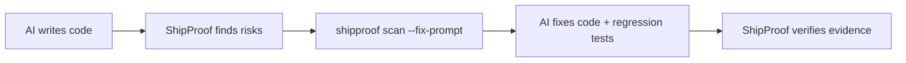

<p align="center">
  
</p>

<h1 align="center">ShipProof</h1>

<p align="center"><strong>ประตู evidence สำหรับ production แบบ local-first สำหรับซอฟต์แวร์ที่ AI ช่วยเขียน</strong></p>

<p align="center"><a href="README.md">English</a> · <a href="README.th.md">ภาษาไทย</a></p>

ความปลอดภัย · ความถูกต้อง · สเกล · ประสิทธิภาพ · หลักฐานก่อน release

[](https://github.com/kingggg5/shipproof/actions/workflows/ci.yml)
[](https://github.com/kingggg5/shipproof/actions/workflows/security.yml)
[](https://github.com/kingggg5/shipproof/blob/main/CHANGELOG.md)
[](package.json)
[](pyproject.toml)
[](LICENSE)

ShipProof คือ production gate ที่พัฒนาขึ้นต้นแบบ independent สำหรับ repository ที่เขียนโดยคน coding agent หรือทั้งสอง มันสแกนซอร์สโดยไม่ execute โค้ดใน repository, ประเมิน budget CPU/RAM/latency ที่วัดจริง, สร้าง model จาก assumption capacity ที่ผ่านการ review และรายงานหลักฐานผ่าน terminal, JSON, SARIF, pre-commit, GitHub Actions หรือ MCP adapter แบบ read-only

ShipProof ไม่ใช่ certification, penetration test, formal proof หรือสิ่งทดแทน threat modeling เฉพาะผลิตภัณฑ์และ runtime test มันทำให้ assumption มองเห็นได้ รายงานความแข็งแรงของหลักฐานที่มี และคงอำนาจการตัดสินใจไว้ที่มนุษย์สำหรับ action ที่มีผลตามมา

**แหล่งข้อมูลโครงการ:** [เว็บไซต์](https://shipproof-site.sjet2744.chatgpt.site/shipproof/) · [Commands](docs/commands.md) · [Contributing](CONTRIBUTING.md) · [Support](SUPPORT.md) · [Governance](GOVERNANCE.md) · [Security](SECURITY.md) · [Community validation](https://github.com/kingggg5/shipproof/blob/main/docs/community-validation.md) · [Research methodology](https://github.com/kingggg5/shipproof/blob/main/docs/research.md) · [Roadmap](https://github.com/kingggg5/shipproof/blob/main/docs/roadmap.md) · [Citation](CITATION.cff)

<p align="center">
  
</p>

## เข้าใจได้ภายใน 30 วินาที

[demo API](examples/demo-api/README.md) ใน repository มีช่องโหว่จริง 5 จุดที่ตั้งใจฝังไว้: admin route ไร้ authorization, SQL แบบ interpolate, pagination ไม่จำกัด, outbound timeout ที่หายไป และ debug mode ใน production

```bash
shipproof scan examples/demo-api/fixtures/before --fail-on high
# BLOCK · 5 findings

python -m unittest discover -s examples/demo-api/fixtures/after/tests -v
shipproof scan examples/demo-api/fixtures/after --fail-on high
# PASS_WITH_EVIDENCE · 0 findings
```

Test suite ตรวจ contract before/after นี้แบบเป๊ะ ๆ และยังมี [fixture Node.js, Python, secure และ performance](fixtures/README.md) คอยกัน finding หลุดและ false positive ระดับโจ่งแจ้ง

## เริ่มต้นอย่างรวดเร็ว

รันใน repository ใดก็ได้โดยไม่ต้องสร้างไฟล์ config ก่อน:

```bash
npx github:kingggg5/shipproof check
```

หรือติดตั้งแบบ global:

```bash
npm install --global github:kingggg5/shipproof
shipproof doctor .
shipproof init . --target both
shipproof check .
```

`init` ติดตั้ง skill ระดับ repository ลง `.agents/skills` สำหรับ Codex และ `.claude/skills` สำหรับ Claude Code

Node.js 20+ ทำหน้าที่ CLI ส่วน Python 3.10+ จำเป็นสำหรับ `scan`, `check`, คำสั่ง `gate`/`labs` ทั้งหมด และเครื่องมือ MCP core ไม่มี dependency npm หรือ Python package เพิ่มเติม

## ขอบเขตและสถานะโครงการ

ShipProof บังคับ review contract เดียวกันไม่ว่าใครเขียนโค้ด executable scanner ปัจจุบันมี **673 deterministic rules** (`SP001`–`SP713`, มีช่องว่างสงวนไว้ตั้งใจ) สำหรับ security, correctness, scale, performance, configuration และ supply-chain risk ที่สังเกตได้ locally path เริ่มต้นเป็น read-only, offline และไม่มี dependency เกิน Node.js กับ Python standard library

| หัวข้อ | Contract ปัจจุบัน |
| :--- | :--- |
| Release ล่าสุด | `v0.12.0` reviewed release |
| Runtime | Node.js 20+; Python 3.10+ สำหรับคำสั่ง scanner-backed |
| Executable rules | 673 (`SP001`–`SP713`, มีช่องว่างสงวนไว้ตั้งใจ) |
| Evidence levels | `L0` pattern, `L1` structural/artifact, `L2` interprocedural taint (`--cross-file`; Python + JavaScript/TypeScript) |
| Research inventory | 7,800 catalogued candidates และ reserved promotion slots 1,000 รายการ; ไม่มีอะไรเป็น finding จนกว่าจะ promote |
| Exit codes | `0` ผ่าน, `1` gate fail, `2` evidence ไม่ถูกต้อง/ไม่พร้อม |
| Data flow เริ่มต้น | Local filesystem และ subprocesses เท่านั้น; ไม่มี telemetry หรือ upload ซอร์ส |

การออกแบบกฎอ้างอิง primary references เช่น [MITRE CWE](https://cwe.mitre.org/), [OWASP ASVS](https://owasp.org/www-project-application-security-verification-standard/), [OWASP API Security](https://owasp.org/API-Security/), [NIST SSDF](https://csrc.nist.gov/pubs/sp/800/218/final), เอกสาร framework ที่เป็นเจ้าของ และ vulnerability records จริง

## Trust model

| ShipProof การันตี | ShipProof ไม่อ้างสิทธิ์ |
| :--- | :--- |
| Output deterministic สำหรับ input/version เดียวกัน | การไม่มี vulnerability หรือ incident ใน production |
| Rule IDs, schemas, fingerprints และ exit semantics `0/1/2` ที่ stable | Cross-file reachability หรือ exploitability ระดับ runtime จาก regex ล้วน |
| Evidence แบบ redact และไม่ execute โค้ด repository ใน scanner default | Certification ตาม CWE, OWASP, NIST หรือมาตรฐานอื่น |
| Unknown/unavailable evidence อย่างชัดเจน ไม่ fabricate ผ่าน | Target/SLO/architecture capacity สากล |
| Severity แบบ review-first สำหรับ heuristic ที่ต้องมี context | สิ่งทดแทน CodeQL, dependency/SBOM tools, fuzzing หรือ human review |

## ตัวอย่างผลลัพธ์ Terminal

ShipProof จัด format findings เป็น review card ที่ actionable พร้อม context, confidence, เหตุผลความเสี่ยง และวิธีแก้:

```text
  [BLOCK] ShipProof: BLOCK
  Scanned 24 files | 1 blocking issue | 0 suppressed
  HIGH: 1

  [HIGH] Sensitive route lacks visible authorization (SP108)
     src/routes/admin.py:42  |  confidence: LIKELY

     Why: An admin or internal route has no visible authorization dependency.
     Fix: Require an explicit authorization dependency or verify application-wide control.
     Ref: CWE-862 | OWASP ASVS V4
```

## Verification workflow

ShipProof เปลี่ยนการพัฒนาให้เป็น verified feedback loop: AI เขียนโค้ด, ShipProof หาความเสี่ยง, AI แก้ตาม constraint ที่ชัดเจน แล้ว ShipProof ตรวจซ้ำ

<p align="center">
  
</p>

ถ้าผลตรวจเป็น `BLOCK` หลักฐานจะย้อนกลับไปที่ขั้นแก้โค้ดและเพิ่มเทส ส่วน `PASS` หมายถึง gate ที่ตั้งไว้มีหลักฐานเพียงพอสำหรับขอบเขตที่ตรวจ ไม่ได้หมายความว่าซอฟต์แวร์ปราศจากช่องโหว่ทุกกรณี

<details>
<summary>ดู workflow ในรูปแบบข้อความ</summary>



</details>

```bash
shipproof scan --fix-prompt        # handoff แบบ structured สำหรับ Codex/Claude Code/Cursor/Copilot
shipproof explain SP108            # rationale, attack scenario, false positives, แผนทดสอบ
shipproof labs impact src/app.py   # blast radius แบบ experimental ก่อนแก้โค้ด
```

ตัวอย่าง prompt เต็ม, invariant analysis, token cost budgeting, worktree isolation, status badges และ output `--trace` อยู่ใน [docs/features.md](docs/features.md)

สำหรับ handoff ในเครื่องแบบ opt-in เตรียม packet ด้วย `shipproof scan . --changed-since HEAD --packet-discover --packet-out ../shipproof-review-packets` แล้วนำ response จาก agent มาใช้ด้วย `--packet-responses ../shipproof-agent-responses.json` โดยใช้ตัวเลือก scan เดิมและซอร์สที่ไม่เปลี่ยน การค้นพบเป็นการเตรียม context ในเครื่อง ไม่เรียก model ไม่สร้าง finding และไม่เพิ่ม gate proof ดูรูปแบบ response และ limits ใน [คู่มือคำสั่ง scan](docs/commands.md)

## กฎการตรวจจับ

**673 deterministic executable rules** (`SP001`–`SP713`, มีช่องสงวนไว้ตั้งใจ) ครอบคลุม security, correctness, scale, performance, configuration และ supply-chain risks ทุก finding มี evidence `proof_level`: `L0` pattern match, `L1` structural/AST/artifact และ `L2` interprocedural taint flows (`--cross-file`; Python plus JavaScript/TypeScript route-to-sink chains ตั้งแต่ v0.8)

ขอบเขต advisory จาก cohort Roblox/Luau, TypeScript และ broad quality:

| Rule | Catalog title | ขอบเขต advisory |
| :--- | :--- | :--- |
| `SP336` | Node inline file stream has no source error handler | ตรวจเฉพาะ imported fs.createReadStream(path).pipe(createWriteStream(path)) โดยไม่มี options, escape, prototype/native handlers; named streams และ Zod pipe ไม่ใช่หลักฐาน |
| `SP690` | Roblox remote directly requires a client-selected module | ต้องมี remote จาก `Instance.new`, handler ที่ไม่ถูก escape, สองพารามิเตอร์แบบง่ายที่ระบุ type ได้ และ sink ตรง statement เดียว; alias, guard, parameter ซับซ้อน และ deployment ยังไม่ทราบ |
| `SP691` | Roblox remote directly removes a client-selected object | ตรวจ Destroy หรือ Kick บน argument ที่ client เลือก ต้องมี native remote และ sink ตรง statement เดียว; ยังไม่ทราบสิทธิ์และ type ของเป้าหมายจริง |
| `SP692` | JWT RSA signing key-size safeguard explicitly disabled | ต้องมี imported `jsonwebtoken.sign`, algorithm RS/PS ที่ระบุชัด และไม่มี header override; ไม่ทราบความแข็งแรงของ key จริง |
| `SP693` | Node HTTP receive deadlines explicitly disabled | ต้องมี imported server options ที่กำหนด request/header timeout เป็น 0 ทั้งคู่; ยังไม่ทราบ bounds ภายนอก |
| `SP694` | Direct await of an empty asynchronous race | ต้อง await `[]` โดยตรงใน native `Promise.race` หรือ Dart `Future.any` ที่ import `dart:async`; ไม่รวม wrapper และ binding ซับซ้อน |
| `SP695` | Native array sort comparator returns a boolean | ต้องเป็น literal array อย่างน้อย 2 elements และ comparator แบบง่ายที่คืน boolean |
| `SP696` | XML entity expansion limit explicitly removed | ต้องส่ง inline settings เข้า `XmlReader.Create` โดยตรง เปิด DTD, limit entity เป็น 0 และไม่มี document cap; ไม่ได้พิสูจน์ external entity |
| `SP697` | Unverified logging configuration listener explicitly started | ต้อง import `logging.config.listen` โดยตรง, port literal ที่ valid, `verify=None` และเรียก `start()` ทันที; listener ปกติรับเฉพาะ loopback |
| `SP698` | Awaited synchronous compression still blocks the caller | ต้อง await synchronous zlib call ที่ import มาโดยตรง; ไม่ทราบขนาด input และงานจริง |
| `SP699` | Rust unchecked NonZero construction receives zero | ต้องเป็น native constructor ที่ระบุ path และค่าศูนย์ชัดเจน ไม่อนุมาน custom module |
| `SP700` | Node timer delay exceeds its supported range | ตรวจตำแหน่ง delay ของ imported callback/promise API รองรับค่าคงที่และผลคูณที่มีขอบเขต |
| `SP701` | SQLAlchemy QueuePool capacity explicitly unlimited | ตรวจ zero size หรือ unlimited overflow ที่ตั้งชัดเจน ไม่เหมารวม default ของ engine |
| `SP702` | React effect setup is an async function | ต้อง import effect และส่ง inline async setup; async งานด้านใน synchronous setup ไม่ถูกแจ้ง |
| `SP703` | Await uses a callback Node I/O API | ต้อง await imported callback pipeline/readFile/writeFile โดยตรง; promises, wrappers และ shadows ไม่ถูกแจ้ง |
| `SP704` | PostgreSQL URL overrides an explicit custom-CA TLS object | ตรวจ imported pg constructor ที่ URL มี SSL parameter และมี CA object แยกกัน ไม่เชื่อมต่อฐานข้อมูล |
| `SP705` | PostgreSQL concurrent index operation is inside a transaction | ตรวจ concurrent CREATE/DROP INDEX หรือ REINDEX INDEX/TABLE ใน transaction ชัดเจนไฟล์เดียว; option อื่นและสถานะ runner ยังไม่ทราบ |
| `SP706` | PostgreSQL definer SELECT searches temporary relations first | ต้องเป็น SQL definer function ที่กำหนด temp-first path และอ่าน relation ไม่ระบุ schema; ไม่อ้างสิทธิ์ deployment |
| `SP707` | Roblox remote mutates client-selected DataStore records | ตรวจ key จาก client กับ SetAsync, RemoveAsync หรือ IncrementAsync ผ่าน native remote ในขอบเขต local |
| `SP708` | Luau numeric range has reversed literal bounds | ตรวจ native integer limits ที่เป็น literal และเรียงกลับด้าน; ค่าเท่ากันไม่แจ้ง |
| `SP709` | Luau in-place table result is consumed as a table | ตรวจการใช้ผล nil ของ table operation แบบตรง |
| `SP710` | Luau writes to a just-frozen table | ตรวจการเขียน field ตรงหลัง freeze literal |
| `SP711` | Luau scheduler receives a noncallable result | ตรวจ native task API ที่รับผลเรียกแบบไม่ใช่ function |
| `SP712` | Roblox DataStore transform directly yields | ตรวจ direct yielding wait ใน native UpdateAsync transform |
| `SP713` | Roblox signal wait supplies an unsupported timeout | ตรวจ timeout argument ที่ API signal Wait ไม่รองรับ |

Finding เหล่านี้เป็น advisory จาก source ในเครื่อง ไม่ใช่หลักฐานว่า deployment ถูกเปิดใช้หรือ exploit ได้ ดู [บันทึก Luau/TypeScript cohort](research/luau-typescript-cohort-2026-10.md), [บันทึก broad-quality cohort](research/broad-quality-cohort-2026-10.md) และ [บันทึก Node/React/Luau/PostgreSQL cohort](research/web-database-cohort-2026-10.md)

[รอบ Node/React/Luau/PostgreSQL](research/web-database-cohort-2026-10.md) เป็น cohort ก่อนหน้า (667 rules ถึง SP706) และเก็บประวัติ SP702–SP706/SP691 ไว้

[รอบ I/O ownership](research/io-ownership-cohort-2026-10.md) เป็นข้อมูลประวัติของ registry 667 rules ถึง SP707. [รอบ Luau community ปัจจุบัน](research/luau-community-cohort-2026-10.md) เพิ่ม SP708–SP713 และขยาย SP707; [manifest source ที่ pin แล้ว](benchmarks/luau-community-cohort-repositories.json)

Reddit, DevForum, Stack Overflow และ GitHub ใช้ช่วยตั้งคำถาม; ยืนยัน semantics จากเอกสารของเจ้าของ API

โค้ดปัจจุบันเพิ่ม advisory checks สำหรับ Roblox/Luau ในไฟล์ `.lua`/`.luau`
(`SP671`–`SP672`) และ Rust invalid reference initialization (`SP673`) พร้อม
ตรวจ reqwest TLS configuration ผ่าน `SP104` ดู syntax ที่รองรับและข้อจำกัดใน
[ตารางกฎ](docs/rules.md) จำนวนกฎนี้อ้างอิง checkout ปัจจุบัน ส่วน release notes
อ้างอิง artifact ของ tag นั้น

ขอบเขต callback Luau รองรับ RemoteEvent และ RemoteFunction แบบง่ายที่ระบุ type
ได้; `SP672` รู้จัก `OnServerInvoke` และ optional return แต่ยังไม่ resolve ownership
ของ event

เพิ่ม TypeScript/JavaScript cohort `SP674`–`SP682` สำหรับ JWT, Node, Next.js,
Electron และ Puppeteer โดยตรวจ runtime import และค่าที่ปิดการป้องกันอย่างชัดเจน
กฎชุดนี้เป็น advisory; type-only import ไม่ trigger `SP591` และถอด `SP429`
ที่แจ้ง default JSON parser ของ Express ผิด ดู [ขอบเขตกฎ](docs/rules.md) และ
[บันทึกแหล่งข้อมูล/เทส](https://github.com/kingggg5/shipproof/blob/main/research/typescript-cohort-2026-10.md)

`SP676` รองรับ imported `jsonwebtoken.sign` ที่ระบุ algorithm RS/PS/ES อย่างชัดเจน
โดยไม่มี header override; `SP679` รองรับ `httpValidation: 'insecure'` บน Node.js
รุ่นที่รองรับ โดย strict/relaxed mode และ legacy switch ที่ขัดกันจะไม่แจ้ง
`SP690`–`SP692` เป็น advisory ตามขอบเขตใน [บันทึก Luau/TypeScript cohort](research/luau-typescript-cohort-2026-10.md)
ไม่ได้ยืนยัน deployment หรือความแข็งแรงของ RSA key จริง

อัปเดตข้อมูลแบบ offline วันที่ **22 ตุลาคม 2026** เพิ่ม PHP2Shell
(`CVE-2026-109618`, `CVE-2026-109619`) ผ่าน `SP683` สำหรับ PHP version pin และ
final official FPM/Apache image ที่ระบุชัด ไม่เดา runtime จาก Composer และไม่สรุปว่า
เครื่องที่มี vendor backport ยังมีช่องโหว่ ต้องตรวจแพตช์และเวอร์ชันที่รันจริงเพิ่มเติม
ดู [ขอบเขตการตรวจ PHP2Shell](docs/rules.md#php2shell-version-evidence)

`SP684` ตรวจ Node.js pin ที่เก่ากว่าแพตช์เดือนตุลาคม 2026 และ `SP685` ตรวจสาขา upstream EOL ทั้งสองเป็น advisory ดู [รูปแบบที่รองรับและข้อจำกัด](docs/rules.md#nodejs-version-declarations)

`SP686`/`SP687` เป็น advisory สำหรับ Node TLS แบบเก่า (ไม่ยืนยัน handshake) และ `ws maxPayload` ที่แปลงเป็น signed 32-bit แล้วไม่เป็นบวก ส่วน C# typed `CookieAuthenticationOptions` ขยาย `SP056`/`SP084` โดย middleware อาจ override ได้ ส่วน HTTP ของ Dart `SP170` ต้องมี imported `package:http`, external HTTP literal และคีย์ Authorization แบบ literal แต่ยังไม่ยืนยันค่าหรือการส่งจริง กฎ FTP/Telnet เดิมไม่เปลี่ยน ดู [ขอบเขต transport](docs/rules.md#transport-and-cookie-options)

field cohort TypeScript/.NET/Dart ก่อนหน้านี้บันทึก advisory `SP688`/`SP689` สำหรับ Next.js image config และ Kestrel options ที่มีขอบเขตแคบ config ใน source ไม่ได้ยืนยัน exploitability หรือ caps จาก proxy/per-request ดู [บันทึก field cohort](research/field-cohort-ts-dotnet-dart-2026-10.md)

cohort broad quality เพิ่ม advisory `SP693`–`SP698`, ปรับขอบเขต `SP346`/`SP375` และ retire `SP348` ตรวจเฉพาะหลักฐานจาก source ไม่อ้างผลใน deployment มีเคสทดสอบ, native API probes, ผลเทียบซอร์สจริง และงบประสิทธิภาพใน [บันทึก cohort](research/broad-quality-cohort-2026-10.md)

[catalog ฉบับเต็ม](https://github.com/kingggg5/shipproof/blob/main/docs/rule-catalog.md) แสดง severity, category และวิธีตรวจของแต่ละกฎ ส่วน [คู่มือกฎ](docs/rules.md) ที่มากับแพ็กเกจอธิบายขอบเขตและ ecosystem ใช้ `shipproof explain SPxxx` อ่านรายละเอียดแต่ละกฎแบบออฟไลน์ได้

## ควบคุม False Positive

ShipProof ให้ความสำคัญกับ precision สูงกว่า alert รก:

ตัวอย่างเช่น `SP631` ต้องเห็นการประกาศ Edge runtime จริงพร้อม native runtime import; Node.js ปกติหรือข้อความที่พูดถึง runtime/ledger ไม่ใช่หลักฐานว่าใช้ Edge ดู [ขอบเขตกฎ](docs/rules.md)

กฎต้องอาศัยบริบทของคำสั่งและ framework ที่เกี่ยวข้อง พร้อมเคสโค้ดปกติที่ต้องไม่เตือน ดู [ขอบเขตการตรวจ](docs/rules.md)

- **Inline suppression:** เติม `# shipproof-ignore SP101` หรือ `// shipproof-ignore SP101` บนบรรทัดนั้นหรือบรรทัดก่อนหน้า marker มีผลเฉพาะใน comment เท่านั้น และระบุหลาย rule พร้อมกันได้ เช่น `# shipproof-ignore SP101 SP102`
- **Confidence filtering:** รันด้วย `--min-confidence high` เพื่อเห็น heuristic findings ที่มี confidence สูง แต่ยังต้องตรวจสอบยืนยัน
- **หมายเหตุด้านความแม่นยำ:** Finding ของ workflow ขึ้นกับ interpolation ในบริบทการรัน, ไฟล์ environment ต้องตรวจจาก Git index จริง (ไม่ใช่ข้อความใน `.gitignore`), BullMQ ต้องมีการปิด stalled checks อย่างชัดเจน, fetch ต้องเป็นคำขออิสระที่อยู่ติดกันใน component เดียวกัน และ non-null ต้อง dereference จาก JSON; ไม่ได้อ้างความแม่นยำสากล
- **Reviewed baselines:** สร้าง `.shipproof-baseline.json` ด้วย `shipproof scan --baseline-out .shipproof-baseline.json --baseline-reason "Reviewed migration debt"` แล้วตรวจทานก่อนใช้ `--baseline` การสร้างไฟล์ไม่ใช่การอนุมัติ; reason เริ่มต้นระบุชัดว่ายังต้อง review
- **การปิด finding ที่ตรวจสอบได้:** Baseline เวอร์ชัน 2 รวม fingerprint ของ finding กับกฎ glob ที่มีเหตุผลประกอบ ดูรายการที่ถูกปิดได้ด้วย `--show-suppressed` ใน JSON, Markdown, terminal หรือ SARIF ซึ่งจะระบุ external suppression ฟิลด์สะกดผิด key ซ้ำ reason ไม่ถูกต้อง หรือ baseline เกินขนาดจะได้ exit `2` ทั้งนี้ fingerprint ไม่ใช่ digest ทั้งไฟล์หรือลายเซ็นอนุมัติ
- **Coverage ที่ไม่กล่าวอ้างเกินจริง:** ไฟล์/directory ที่อ่านไม่ได้, parser limit, บรรทัด source ยาวเกิน 8,192 ตัวอักษร, source เกินขนาด, symlink/reparse point, binary ที่ไม่รู้จัก และ container ที่ยังไม่ตรวจ ป้องกัน verdict แบบ complete pass; repository scan จะ fail-closed เมื่อ coverage ไม่ครบเป็นค่าเริ่มต้น และยังรับ `--fail-on-incomplete` เพื่อสื่อเจตนาใน command ได้ ส่วน `--allow-incomplete` เป็น exploratory override ที่เห็นชัดเจนเท่านั้น Action และ MCP ก็ strict เป็นค่าเริ่มต้น (ตั้ง boolean เป็น `false` ได้เฉพาะ exploratory run ที่ review แล้ว และ adapter จะแปลงเป็น `--allow-incomplete`) ส่วน `check` จะบังคับ full root, security floor ระดับ high และ fail-closed แม้ policy ใน repository จะพยายามลดระดับหรือจำกัด scope evidence ที่ไม่ครบจะเป็น `CONDITIONAL` แต่ process exit เป็น `1` จึงไม่เปลี่ยนเป็น green gate แบบเงียบ ๆ Coverage นี้หมายถึง source ที่รองรับ ไม่ได้รับรองความปลอดภัยขณะรัน ดู [รายละเอียด contract](docs/commands.md#coverage-and-baseline-contracts)
- **Cross-file coverage:** ข้อจำกัดในการอ่าน/parse graph ถือเป็น coverage failure ไม่ใช่ vulnerability finding; partial findings ยังแสดงอยู่ `scan --cross-file` แบบ strict exit `1` เมื่อ coverage ไม่ครบ ส่วน `--allow-incomplete` คงรายงานแบบ exploratory และ conditional; scan ปกติ rules fingerprints และ thresholds ไม่เปลี่ยน ส่วน `labs impact` รายงาน graph evidence ที่ไม่ครบเป็น `UNKNOWN` และ exit `2` ดู [limits ของ cross-file และ impact](docs/commands.md#scan)

## เพิ่ม GitHub Action

ใส่ deterministic gate ให้ pull request:

```yaml
name: ShipProof
on: [pull_request]
permissions:
  contents: read
jobs:
  production-gate:
    runs-on: ubuntu-latest
    steps:
      - uses: actions/checkout@v4
      - uses: kingggg5/shipproof@v0.12.0
        with:
          fail-on: high
```

Action เขียน status card Markdown ลง GitHub Step Summary สำหรับ PR ที่แตะ repository ใหญ่ ให้ scan เฉพาะสิ่งที่เปลี่ยน:

```yaml
      - uses: actions/checkout@v4
        with:
          fetch-depth: 0
      - uses: kingggg5/shipproof@v0.12.0
        with:
          fail-on: high
          changed-since: origin/main
```

Format รายงาน default คือ `sarif` จะอัปโหลดเป็น Code Scanning alerts ให้ใช้ official action ของ GitHub ต่อจาก gate step และต้องการ `permissions: security-events: write` (คง `contents: read`) ที่ job หรือ workflow

## นโยบายเดียว หนึ่งคำสั่ง

Commit [.shipproof.yml](.shipproof.yml) ที่ bound ไว้ แล้วรัน gate ทุกตัวที่ประกาศ:

```bash
shipproof check .
```

YAML subset แบบ dependency-free จะ reject executable tags, anchors, duplicate keys, unknown fields, path traversal และ arbitrary commands รูปแบบเต็มดูได้ที่ [policy schema](schemas/shipproof-policy.schema.json)

## สอง skill หนึ่ง workflow

| Skill | ใช้เมื่อ |
| :--- | :--- |
| `$engineer-production-systems` | implement แบบ bounded พร้อม budget security, CPU/RAM/latency และ failure ที่ชัดเจน |
| `$audit-production-readiness` | release gate อิสระ: Security, Correctness, Data & Privacy, Scale, Operability, Supply Chain |

Workflow diagram ฉบับเต็ม, systems coverage ladder, ตาราง compatibility ของ host และ production playbook อยู่ใน [docs/features.md](docs/features.md) และ [docs/production-playbook.md](docs/production-playbook.md)

## Command Reference

```text
shipproof check [path] [--config <file>]     Run every gate (works without config)
shipproof scan [path] [options]              Scan repository (--format terminal|markdown|json|sarif|github)
shipproof explain <rule-id>                  Explain a rule in detail (e.g. explain SP108)
shipproof doctor [path] [--json]             Inspect local runtime and integration health
shipproof init [path] [--scope <scope>]      Add project/global skills and a project policy
shipproof config validate [path]             Validate policy without running gates
shipproof gate budget [options]              Enforce CPU/RAM/latency regression budgets
shipproof gate evidence [path] [options]     Run allowlisted TypeScript, Go, or Rust analyzers
shipproof labs impact <file>[:line]          Experimental blast-radius analysis
shipproof labs invariants [path]             Experimental invariant analysis
shipproof labs cost [path] [options]         Experimental token/cost estimate
shipproof labs capacity [options]            Experimental capacity model and k6 export
shipproof mcp                                Start the read-only stdio MCP server
shipproof help                               Show command help
shipproof version                            Print current version
```

ดู [docs/commands.md](docs/commands.md) สำหรับ options และ exit codes ฉบับเต็ม

## ติดตั้งจาก Clone

```bash
git clone https://github.com/kingggg5/shipproof.git
cd shipproof
npm install --global .
```

จากนั้นเรียกใช้ skill ขณะ build:

```text
Use $engineer-production-systems to implement this feature with explicit security,
CPU, RAM, latency, and failure budgets.
```

ก่อน release:

```text
Use $audit-production-readiness to audit this repository for production.
```

Claude Code โหลด repository เป็น plugin ระหว่าง development ได้ด้วย `claude --plugin-dir .`

## Budgets, capacity, MCP และ layering

- **Resource budgets:** gate regression ของ p95 latency/CPU/RAM/throughput ที่วัดจริงด้วย `shipproof gate budget`; ตัวอย่างรันได้ใน [examples/performance](examples/performance)
- **Capacity planning:** เปลี่ยน workload assumption ที่ผ่าน review เป็น model โปร่งใสหรือ k6 scaffold แบบ deterministic ด้วย `shipproof labs capacity`
- **MCP mode:** `shipproof mcp` เปิด five read-only tools ให้ MCP client ใดก็ได้ พร้อม canonical paths, bounded runtime และ evidence แบบ redact
- **Language-native evidence:** `shipproof gate evidence . --adapter typescript|go|rust` รัน approved analyzers ในเครื่องโดยไม่ดาวน์โหลด dependency
- **Layering:** ใช้คู่กับเครื่องมือ SAST/SCA/secret-history/supply-chain ที่มีอยู่แล้วในสภาพแวดล้อมของคุณ; ShipProof route ไปยังเครื่องมือที่มีอยู่แล้วและไม่ install แอบ ๆ

รายละเอียดทุก walkthrough อยู่ใน [docs/features.md](docs/features.md)

## วิธีวิจัยและ provenance

ShipProof implement ขึ้นต้นแบบ independent references ถูกใช้เพื่อกำหนดคำถาม ศัพท์ และขอบเขตความปลอดภัยที่คาดหวัง; detector code ภายนอกและ ruleset ที่มี license จำกัดไม่ถูกคัดลอก [research notebook](https://github.com/kingggg5/shipproof/blob/main/docs/research.md) บันทึกหน้าที่ consult, คำถามที่ถาม, การตัดสินใจที่ retain และ claim ที่ไม่ infer ตั้งแต่ต้น

candidate จาก research จะกลายเป็น executable `SPxxx` rule ได้หลัง deduplication, local invariant ที่สังเกตได้, bounded implementation, CWE/control mapping, remediation, false-positive analysis และ positive/negative/adversarial tests เท่านั้น severity สื่อ potential impact ของเงื่อนไขที่ match; proof level สื่อความแข็งแรงของหลักฐาน local: ไม่มีตัวไหนคือ probability of exploitation

| Research artifact | ขอบเขต | ผลต่อ runtime |
| :--- | :--- | :--- |
| [Expert candidate catalog](https://github.com/kingggg5/shipproof/blob/main/docs/rule-expansion-1000.md) | 1,000 non-executable hypotheses จาก model-assisted mapped กับ source | ไม่มี |
| [2021–2026 annual catalog](https://github.com/kingggg5/shipproof/blob/main/docs/rule-expansion-2021-2026.md) | 1,800 non-executable candidates ตามช่วงเวลา | ไม่มี |
| [Language catalog](https://github.com/kingggg5/shipproof/blob/main/docs/rule-expansion-languages-5000.md) | 5,000 non-executable candidates แยก ecosystem/CWE | ไม่มี |
| [Executable rule table](docs/rules.md#detection-rules-reference) | 673 detectors | Emit versioned findings |

รายการ expert/annual 2,800 รายการและ language catalog 5,000 รายการเป็น research candidates ไม่ใช่ executable rules และยัง emit findings ไม่ได้จนกว่าจะ promote แยกต่างหาก

ดู [production playbook](docs/production-playbook.md), [development plan](https://github.com/kingggg5/shipproof/blob/main/docs/next-development-plan.md) และ [delivery roadmap](https://github.com/kingggg5/shipproof/blob/main/docs/roadmap.md) สำหรับขอบเขต operational และ acceptance gates อ้างอิง release ด้วย [CITATION.cff](CITATION.cff)

## การกำกับดูแลโครงการ

ShipProof ใช้ decision model แบบ maintainer-led เน้น evidence เรื่อง backward compatibility, rule promotion, releases, security response และการเปลี่ยน trust boundary default เป็นไปตาม [GOVERNANCE.md](GOVERNANCE.md) การ contribute ต้อง follow [CONTRIBUTING.md](CONTRIBUTING.md) และ [Code of Conduct](CODE_OF_CONDUCT.md) vulnerability ที่ exploit ได้รายงานผ่านช่องทาง private ตาม [SECURITY.md](SECURITY.md)

## Development

```bash
npm ci --ignore-scripts
python -m pip install -r requirements-dev.txt
npm run check
python skills/audit-production-readiness/scripts/scan_repo.py . --fail-on high
```

Core runtime ใช้แค่ Node กับ Python standard library; Ruff เป็น dev-only ส่วน MCP adapter แบบ optional ใช้ MCP SDK และรองรับ Zod 3 กับ 4 (`^3.25.76 || ^4.6.7`) โดยติดตั้ง peers เอง CI ทดสอบ Node 20/22/24 และ Python 3.10/3.11/3.12/3.13/3.14, ตรวจ package allowlist แบบเป๊ะ, smoke-test packed artifact และรัน CodeQL สำหรับ Python กับ JavaScript/TypeScript

scoped npm manifest และ manual OIDC workflow พร้อมสำหรับ public npm release ในอนาคต แต่จนกว่าเจ้าของจะสร้าง package, protected environment และ trusted-publisher relationship ให้ใช้วิธีติดตั้งจาก GitHub ด้านบนก่อน โครงการไม่อ้างว่าเผยแพร่ package ที่ยังไม่มีใน registry ดู [docs/releasing.md](https://github.com/kingggg5/shipproof/blob/main/docs/releasing.md) สำหรับ release discipline

## License, citation และ security

ShipProof เผยแพร่ภายใต้ [MIT License](LICENSE) ผู้ใช้งานเชิงวิชาการอ้างอิงโครงการได้ผ่าน [CITATION.cff](CITATION.cff) รายงาน vulnerability แบบ private ตาม [SECURITY.md](SECURITY.md)
